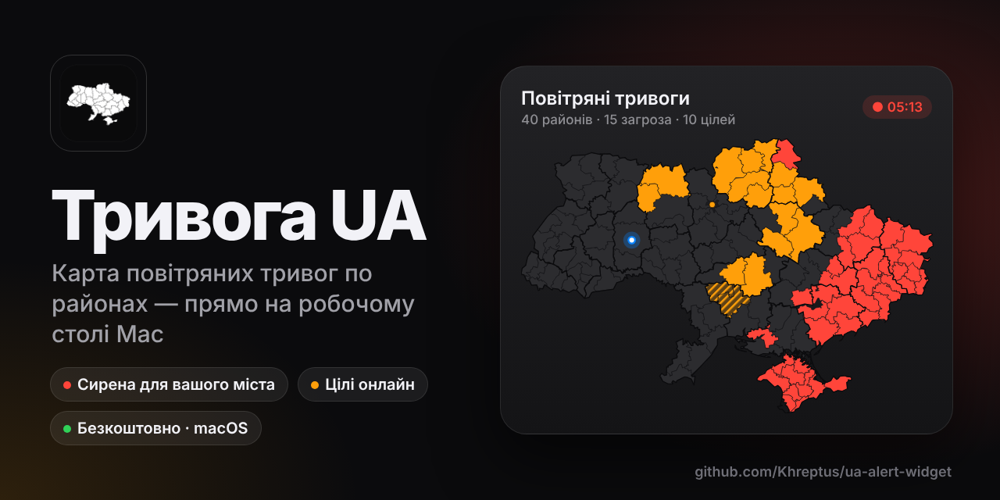

# Тривога UA — карта повітряних тривог України для macOS

**Тривога UA** — безкоштовна **карта повітряних тривог України** по районах на робочому столі Mac: **віджет тривог**, **сирена** для вашого міста, **повітряні цілі** онлайн. Сайт: https://khreptus.github.io/ua-alert-widget/

- **Віджет на робочому столі** — оновлюється кожні ~6 с, кнопка «⋯» відкриває налаштування.
- **Значок у рядку меню** — статус вашого міста, сирена, вихід.
- **Стандартний віджет macOS** (Small / Medium / Large) — місто обирається в налаштуваннях віджета.

## Встановлення
1. Відкрийте [Releases](../../releases/latest) і завантажте `UA-Alert.dmg`.
2. Відкрийте DMG і перетягніть **UA Alert** у «Програми».
3. Перший запуск: програма не підписана Apple, тому macOS її заблокує. Відкрийте «Системні параметри → Конфіденційність і безпека» і натисніть **«Все одно відкрити»**.
4. Дозвольте сповіщення — так прийде банер із сиреною.

## Дані
| Джерело | Що беремо |
|---|---|
| map.ukrainealarm.com | Офіційні тривоги (область / район / громада), цілі |
| dimap.live | Тривоги, загрози (жовтий), цілі |
| radarua.com | Тривоги — резерв |

Повітряні цілі — **лише** з dimap.live і ukrainealarm.

## Збірка
GitHub Actions (`.github/workflows/build.yml`) на кожен push у `main` генерує проєкт через XcodeGen, збирає його і публікує `UA-Alert.dmg` у Releases.

---

### По-русски
**Тривога UA** — бесплатная **карта воздушных тревог Украины** для Mac (macOS). Есть виджет на рабочем столе и значок в строке меню, тревоги показываются по районам и громадам. Для вашего города срабатывает **сирена** с уведомлением, на карте видны воздушные цели онлайн. Скачать: [UA-Alert.dmg](https://github.com/Khreptus/ua-alert-widget/releases/latest/download/UA-Alert.dmg)

### In English
**UA Alert** is a free **air raid alert map of Ukraine** for macOS. It offers a desktop widget, a menu bar icon and native macOS widgets. Alerts are shown by district and community, with a **siren** and notification for your city and live air threats on the map. Download: [UA-Alert.dmg](https://github.com/Khreptus/ua-alert-widget/releases/latest/download/UA-Alert.dmg)

**Ключові слова:** карта тривог, повітряна тривога, віджет тривог для Mac, сирена, повітряні цілі, карта воздушных тревог, воздушная тревога Украина, air raid alert Ukraine, air alert map, macOS widget.
